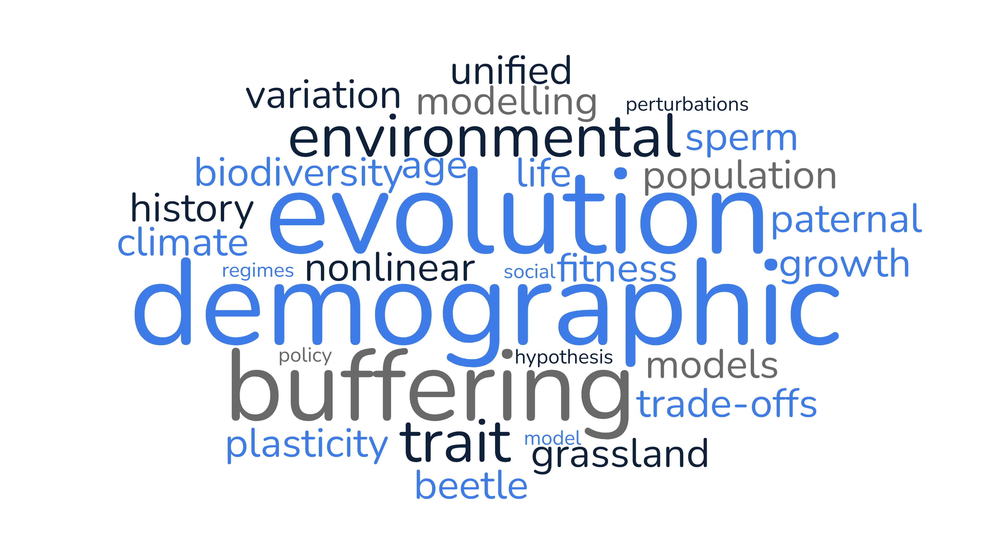

::: {.stat-row}

::: {.stat}
[39]{.stat-num} [manuscripts]{.stat-label}
:::

::: {.stat}
[28]{.stat-num} [published]{.stat-label}
:::

::: {.stat}
[6]{.stat-num} [in press]{.stat-label}
:::

::: {.stat}
[5]{.stat-num} [under review]{.stat-label}
:::

::: {.stat}
[11]{.stat-num} [h-index]{.stat-label}
:::

:::

::: {.profile-links}
[<i class="bi bi-mortarboard"></i> Google Scholar](https://scholar.google.com/citations?user=vQzYzlAAAAAJ&hl=en){.btn .btn-outline-primary .btn-sm}
[ORCID](https://orcid.org/0000-0002-2984-1810){.btn .btn-outline-primary .btn-sm}
[ResearchGate](https://www.researchgate.net/profile/Samuel-Gascoigne){.btn .btn-outline-primary .btn-sm}
[Web of Science](https://www.webofscience.com/wos/author/record/ITV-8261-2023){.btn .btn-outline-primary .btn-sm}
[Scopus](https://www.scopus.com/authid/detail.uri?authorId=57202744858&origin=resultslist){.btn .btn-outline-primary .btn-sm}
:::

::: {.callout-note appearance="simple"}
Click any reference to expand a short summary and, where available, the PDF.
\* = shared first authorship; + = mentored student.
:::

{fig-align="center" width="420" fig-alt="Word cloud of research topics"}

## Under review (5)

::: {.pub}

  

  
  39| Sanghvi K\*, **Gascoigne SJL\***, Sepil I. Mechanisms of phenotypic trade-offs in the resource acquisition-allocation Y-model.
*Ecology Letters*. Under review.

  
  

  
  *Here, we introduce a new framework for hypothesizing phenotypic correlations from a Y-model paradigm using a ratio of coefficients of variation in resource acquisition and allocation.*

:::

::: {.pub}

  

  
  38| Salguero-Gómez R, Santos G, Brent L, **Gascoigne SJL**, Bonsall M, Firth J, Albery G, Mondal R, Kajin M, & Davis K. Support for the social buffering hypothesis, especially under unpredictable regimes. *Journal of Animal Ecology* . Under review. ([preprint link](https://www.biorxiv.org/content/10.1101/2025.04.30.651380v2.abstract))

  
  

  
  *Here, we combine two disparates areas of buffering in population biology - scoial buffering and demographic buffering. Specifically, we perform a comparative study of animal species that illustrates sociality positively correlates with a population's ability to demographically buffer.*

:::

  

::: {.pub}

  

  
  37| **Gascoigne SJL**, Kajin M, Sepil I, Salguero-Gómez R. Testing for efficacy in four measures of demographic buffering. *Methods in Ecology & Evolution*. Under review. ([preprint link](https://ecoevorxiv.org/repository/view/7207/))
  
  

  
  *Here, we show how the summation of stochastic elasticities of variance is an effective measure of demographic buffering using four environmentally explicit integral projection models (IPMs) and a series of counterfactual simulations.*

  
  <object data="publications/Gascoigne et al. 2024 Efficacy.pdf" type = "application/pdf" width = "100%" height = "325px" class="pub-pdf">
</object>
  

:::

::: {.pub}

  

  
  36| Huang Y, Wu C, Huang W, Liu Y, Qi M, Bai J, Dong Y, **Gascoigne SJL**, Ciais P, Peñuelas J, Salguero-Gómez R. Climate change has desynchronized insect and vegetation phenologies across Europe. *Global Change Biology*. Under review. ([preprint link](https://www.biorxiv.org/content/10.1101/2023.12.11.571152v1.abstract))
  
  

  
  *Here, we show how climate change is increasing the asynchrony of phenologies of plant and insect species across Europe. This asynchrony is structured across taxa, life history and well as latitude.*

  
  <object data="publications/Huang et al. 2023.pdf" type = "application/pdf" width = "100%" height = "325px" class="pub-pdf">
</object>
  

:::

::: {.pub}

  

  
  35| **Gascoigne SJL**, Rosen A, Sanghvi K, Compagnoni A, Steiner UK, Bocedi G, Sepil I. Current perspectives and future directions in animal life history evolution. *Journal of Animal Ecology*. Under review. ([preprint link](https://www.authorea.com/users/657075/articles/670780-current-perspectives-and-future-directions-in-animal-life-history-evolution))
  
  

  
  
  *Here, we both review the current state of research in animal life history evolution and offer three new research programs that address specific gaps in knowledge.*

  
  <object data="publications/Gascoigne et al. 2023 Current perspectives.pdf" type = "application/pdf" width = "100%" height = "325px" class="pub-pdf">
</object>
  

:::

## In press (6)

::: {.pub}

  

  
  34| Kajin M, Tuljapurkar S, Zuo W, Jaggi H, **Gascoigne SJL**, Salguero-Gómez R. Second-order elasticities for ecology and evolution: Unravelling nonlinear fitness responses to perturbations. *Ecology*. In press. ([preprint link](https://www.biorxiv.org/content/10.1101/2025.04.30.651456v1.abstract)) 

  
  

  
  *Here, we summarize linear and non-linear approaches to calulating elasticities of population growth rate with respect to demographic rates.*

:::

::: {.pub}

  

  
  33| Santos GS, Yang X, **Gascoigne SJL**, Compagnoni A, Dias ATC, Tuljapurkar S, Kajin M, Salguero-Gómez R. Population responses to environmental stochasticity are primarily driven by survival-reproduction trade-offs and mediated by aridity. *Nature Communications*. In press. ([preprint link](https://www.biorxiv.org/content/10.1101/2024.07.24.604949v1))
  
  

  
  *Our study builds on previous work using the summation of stochastic elasticities of variance. Here, we show demographic buffering is driven by life history trade-offs and degree of climate aridity.*

<object data="publications/Santos et al. 2024.pdf" type = "application/pdf" width = "100%" height = "325px" class="pub-pdf">
</object>
  
  

:::

::: {.pub}

  

  
  32| Morrison C, Gregory J, Jackson C, Bestwick J, Schroeder K, **Gascoigne SJL**, Bills P, Porro LB, Mannion PD, Barrett PM.Inter- and intraspecific variation in theropod dinosaur dental microwear and its palaeoecological implications. *The Anatomical Record*. In press. ([early view link](https://anatomypubs.onlinelibrary.wiley.com/doi/10.1002/ar.70170))

  
  

  
  *Here, we show the similarities and differences of microwear metrics from multiple teeth locations derived in theropod dinosaurs.*

:::

::: {.pub}

  

  
  31| Tuljapurkar SD, Jaggi H, **Gascoigne SJL**, Zuo W, Kajin M, Salguero-Gómez R. From disturbances to nonlinear fitness and back. *Ecology*. In press. ([preprint link](https://www.biorxiv.org/content/10.1101/2023.10.20.563360v2.abstract))
  
  

  
  *Here, we identify an intimate relationship between the responses of structured populations to pulse and press disturbance and their associated second derivatives of \lambda with respect to demographic rates.*

  
  <object data="publications/Tulja et al 2023.pdf" type = "application/pdf" width = "100%" height = "325px" class="pub-pdf">
</object>
  

:::

::: {.pub}

  

  
  30| Rosen A, Battison R, Hernández C, Spacey O, McLean J, Prober S, **Gascoigne SJL**, McMahon S, Jucker T, Salguero-Gómez R. Modelling forest dynamics using integral projection models (IPMs) and repeat LiDAR. *Methods in Ecology & Evolution*. In press. ([early view link](https://zslpublications.onlinelibrary.wiley.com/doi/10.1002/rse2.70050))

  
  

  
  *Here, we demonstrate a pipeline for constructing structured population models, in the form of IPMs, from repeat LiDAR data for tree populations.*

<object data="publications/Rosen et al. 2025.pdf" type = "application/pdf" width = "100%" height = "325px" class="pub-pdf">
</object>

:::

::: {.pub}

  

  
  29| Li D, Hu Y, Salguero-Gómez R, **Gascoigne SJL**, Qing W, Meisi R, Weiwei X, Wei W, Haitao M, Li S. Clonal integration differentially impacts grassland plants under simulated homogeneous and heterogeneous grazing. *Journal of Plant Ecology*. In press. ([accepted manuscript link](https://academic.oup.com/jpe/advance-article/doi/10.1093/jpe/rtaf212/8383743))
  
  

  
  *Our study shows that clonal integration and heterogenous grazing behaviours can lead to increased productivity in a grassland species.*

:::

## 2026 (5)

::: {.pub}

  

  
  28| Boisvert C, Perkins J, Morrison C, **Gascoigne SJL**, Holtz TR, Curtice B. Hypercarnivorous megatheropod size class patterns across the Jurassic-Cretaceous Periods. *PeerJ*. *14*:e21007. ([link](https://peerj.com/articles/21007/))

  
  

  
  *Here, we suggest that the distribution of size classes across five clades of hypercarnivorous megatheropods may have arisen through ecological mechanisms.*

 
  

:::

::: {.pub}

  

  
  27| Santos GS\*, **Gascoigne SJL\***, Dias ATC, Kajin M, Salguero-Gómez R. A unified framework to identify demographic buffering in natural populations. 2026. *Journal of Animal Ecology*.*00*:1–13. ([link](https://besjournals.onlinelibrary.wiley.com/doi/10.1111/1365-2656.70226))

  
  

  
  *Here, we propose a new framework for the quantification of demographic buffering in structured populations using stochastic elasticities and second-order derivatives of population growth rate with respect to demographic rates.*

 
  

:::

::: {.pub}

  

  
  26| Wang XY, Hu YK, Li DD, Miao HT, Hernández C, **Gascoigne SJL**, Li SL. Rainfall timing and intensity jointly affect the survival and growth of seedling and juvenile Poa crymophila in alpine rangelands on the Qinghai-Tibetan Plateau. 2026. *Ecological Processes*. *15*(2). ([link](https://link.springer.com/article/10.1186/s13717-026-00671-y))

  
  

  
  *Summary to come.*

 
  

:::

::: {.pub}

  

  
  25| Zurell D, Albert C, Bocedi G, Briscoe N, Buckley LB, **Gascoigne SJL**, Gonzalez A, Guillera-Arroita G, Isaac N, Karger D, Lundquist C, Merow C, Cabral JS, Schifferle K, Velazco S, Urban M. Biodiversity science and policy need more model intercomparisons. 2026. *Nature Reviews Biodiversity*. *2*, 204-215. ([link](https://www.nature.com/articles/s44358-026-00134-4))

  
  

  
  *Here, we suggest identify a key gap in our ability to forecast biodiversity in the Anthropocene. Specifically, we argue that models implicitly bias forcasts and, just as intercomparisons improved climate projections, model intercomparisons are vital for effective biodiverstiy forecasts.*

 
  

:::

::: {.pub}

  

  
  24| Uwera Nalukwago D+, **Gascoigne SJL**, DeFoe B, Barbosa F. A proximate mechanism for evolutionary trade-offs in the bean beetle Callosobruchus maculatus. 2026. *Biological Journal of the Linnean Society*. *147*(1), blaf145.([link](https://academic.oup.com/biolinnean/article/147/1/blaf145/8422494))
  
  

  
  
  *Here, we show how juvenile hormone underlies the generation of density-dependent dispersal morph generation in the bean beetle, Callosobruchus maculatus.*

  
  

 
  

:::

## 2025 (10)

::: {.pub}

  

  
  23| Vinton AC, Ibbott B, Chen J, **Gascoigne SJL**, Coulson T, Sepil I. Environmental predictability drives different routes to adaptation. 2025. *Evolution Letters*. qraf052. ([link](https://academic.oup.com/evlett/article/10/2/173/8407546))

  
  

  
  *Through a high throughput evolution experiment using Drosophila melanogaster, we demonstrate the role of environmental predictability in life history evolution trajectories across generations.*

<object data="publications/Vinton et al. 2025.pdf" type = "application/pdf" width = "100%" height = "325px" class="pub-pdf">
</object>

 
  

:::

::: {.pub}

  

  
  22| Zurell D, Bocedi G, Santiago JEV, Gonzalez A, Purvis A, Wintle B, Merow C, Lundquist C, Guillera-Arriota G, Settele J, Serra-Diaz JM, Cabral JS, Travis JMJ, Schifferle K, Buckley L, Briscoe NJ, Isaac NJB, Peres-Neto PR, Keuth R, **Gascoigne SJL**, Ferrier S, Urban MC. Predicting the way forward for the Global Biodiversity Framework. 2025. *Proceedings of the National Academy of Sciences*. *122*(41) e2501695122. ([link](https://www.pnas.org/doi/abs/10.1073/pnas.2501695122))
  
  

  
  *Here, we make a pitch for the introduction of predictive modelling as a key component for the coordination and facilitation of the goals set in the Kunming-Montreal Global Biodiversity Framework.*

<object data="publications/Zurell et al. 2025.pdf" type = "application/pdf" width = "100%" height = "325px" class="pub-pdf">
</object>

 
  

:::

::: {.pub}

  

  
  21| Gupta A, **Gascoigne SJL**, Barabás G, Qi M, Fenollosa E, Thornley R, Hernández C, Hector A, Salguero-Gómez R. Variation in precipitation drives differences in short-term transient instability between grassland functional groups: A stage structured community approach. 2025. *Ecology Letters*. *28*(8), e70182. ([link](https://onlinelibrary.wiley.com/doi/full/10.1111/ele.70182))
  
  

  
  *Our study shows how precipitation can lead to transient instability in grassland communities.*

<object data="publications/Gupta et al. 2025.pdf" type = "application/pdf" width = "100%" height = "325px" class="pub-pdf">
</object>

 
  

:::

::: {.pub}

  

  
  20| Sanghvi K, **Gascoigne SJL**, Todorova B, Vega-Trejo R, Pizzari T, Sepil I. No evidence for paternal age effects on sons or daughters, when accounting for paternal sperm storage. 2025. *The American Naturalist*. *206*(2), E29-E46. ([link](https://www.journals.uchicago.edu/doi/full/10.1086/736479))
  
  

  
  *Our study implicates sperm age as a primary driver of male age related declines in sperm performance in Drosophila melanogaster.*

<object data="publications/Sanghvi et al. 2024 sperm age.pdf" type = "application/pdf" width = "100%" height = "325px" class="pub-pdf">
</object>

 
  

:::

::: {.pub}

  

  
  19| Morrison C, Scherer C, O'Callaghan E, Layton C, Boisvert C, Aranciaga-Rolando M, Durrant L Salas P, Allain S, **Gascoigne SJL**. Rise of the King: Gondwanan Origins and Evolution of Megaraptoran Dinosaurs. 2025. *Royal Society Open Science*. *12*:242238. ([link](https://royalsocietypublishing.org/doi/full/10.1098/rsos.242238))
  
  

  
  *Using biogeographic models, we show Megaraptorans may have had a cosmopolitan distribution prior to the splitting of Laurasia and Gondwana. Also, gigantism in these clades may be associated with climatic shifts in the Late Cretaceous.*

  
  <object data="publications/Morrison et al. 2025.pdf" type = "application/pdf" width = "100%" height = "325px" class="pub-pdf">
</object>

 
  

:::

::: {.pub}

  

  
  18| **Gascoigne SJL**, Kajin M, Tuljapurkar SD, Santos GS, Compagnoni A, Steiner UK, Vinton AC, Jaggi H, Sepil I, Salguero-Gómez R. Structured demographic buffering: A framework to explore the environment drivers and demographic mechanisms underlying demographic buffering. 2025. *Ecology Letters*. *28*:e70066. ([link](https://onlinelibrary.wiley.com/doi/full/10.1111/ele.70066))
  
  

  
  
  *Here, we use environment stochastic integral projection models to show how environment components impact demographic buffering by different mechanisms.*

  
  <object data="publications/Gascoigne et al. 2025 Structured demographic buffering.pdf" type = "application/pdf" width = "100%" height = "325px" class="pub-pdf">
</object>
  

 
  

:::

::: {.pub}

  

  
  17| Xiao-Lu ST, Yu-Kun H, Katriona S, **Gascoigne SJL**, Qing W, Li-Chen T, Dan-Dan L, Li SL. Seedling size affects the strategy of dune seedlings responding to rainfall variation. 2025. *Annals of Botany*. mcaf017. ([link](https://academic.oup.com/aob/advance-article/doi/10.1093/aob/mcaf017/8005844?login=true))
  
  

  
  *Our study demonstrates that germination timing may strongly affect the responses of seedlings to rainfall variation, suggesting that plants with flexible germination timing may better adapt to rainfall fluctuations, and thus more suitable for desert vegetation restoration under climate change. *

  

 
  

:::

::: {.pub}

  

  
  16| Noble DWA, Zoe A, Xirocostas ZA, Wu NC, Martinig AR, Almeida RA, Bairos-Novak KR, Heikel Balti H, Bertram MG, Bliard L, Brand JA, Byrne I, Chan YC, Clink DJ, Corbel Q, Correia RA, Crawford-Ash J, Culina A, D’Bastiani E, Deme GG, de Souza Leite M, Dhellemmes F, Dimri S, Drobniak SM, Elsy AD, Everingham SE, **Gascoigne SJL**, Grainger MJ, Hossack GC, Hovstad KA, Ivimey-Cook ER, Jones ML, Kačergytė I, Küstner G, Leibold DC, Mair MM, Martin J, Mizuno A, Moodie IR, Moreau D, O’Dea RE, Orr JA, Paquet M, Parajuli R, Pick JL, Pottier P, Purgar M, Recio P, Roche DG, Royauté R, Sabet SS, Segovia JMG, Silva I, Sánchez-Tójar A, Soares BE, Szabo B, Takola E, Thoré ESJ, Timilsina B, van Dis NE, Verberk WCEP, Vriend SJG, Wild KH, Williams C, Yang Y, Nakagawa S, Malgorzata Lagisz M. 2025. The promise of community-driven preprints in ecology and evolution. *Proceedings of the Royal Society B*. *292*(2039). ([link](https://royalsocietypublishing.org/doi/10.1098/rspb.2024.1487#d1e3050))
  
  

  
  
  *Here, we explore the first preprints uploaded to EcoEvoRxiv to characterise preprint practices in ecology and evolution.*

<object data="publications/Noble et al. 2025.pdf" type = "application/pdf" width = "100%" height = "325px" class="pub-pdf">
</object>

 
  

:::

::: {.pub}

  

  
  15| Veit W, **Gascoigne SJL**, Salguero-Gómez R. 2025. Evolution, complexity, and life history theory. 2025. *Biological Theory*. ([link](https://doi.org/10.1007/s13752-024-00487-z))
  
  

  
  
  *Here, we begin the philosophical argument for a new approach to quantify life history complexity in structured population models.*

  
  <object data="publications/Veit et al. 2025.pdf" type = "application/pdf" width = "100%" height = "325px" class="pub-pdf">
</object>
  

 
  

:::

::: {.pub}

  

  
  14| Sanghvi K, Shandilya S, Brown A, Todorova B, Jahn M, **Gascoigne SJL**, Camilleri TL, Pizzari T, Sepil I. 2025. Reproductive output of old males is limited by seminal fluid, not sperm number. *Evolution Letters*. qrae071, 1-10. ([link](https://academic.oup.com/evlett/advance-article/doi/10.1093/evlett/qrae071/7943589))
  
  

  
  *Our study demonstrates that seminal fluid is the limiting resource for multiple mating males - not sperm number.*

<object data="publications/Sanghvi et al. 2025.pdf" type = "application/pdf" width = "100%" height = "325px" class="pub-pdf">
</object>
  
  

 
  

:::

## 2024 (2)

::: {.pub}

  

  
  13| Sanghvi K, Vega-Trejo R, Nakagawa S, **Gascoigne SJL**, Johnson S, Salguero-Gómez R, Pizzari T, Sepil I. 2024. No consistent declines in ejaculate traits with advancing male age across animals: a meta-analysis. *Nature Communications*. *15*(558).  ([link](https://www.nature.com/articles/s41467-024-44768-4))
  
  

  
  
  *Here, we perform a meta-analysis testing the presence of senescence in ejaculate traits across non-human animals.*

  
  <object data="publications/Sanghvi et al. 2024.pdf" type = "application/pdf" width = "100%" height = "325px" class="pub-pdf">
</object>
  

 
  

:::

::: {.pub}

  

  
  12| **Gascoigne SJL**, Kajin M, Salguero-Gómez R. 2024. Criteria for buffering in ecological modelling. *Trends in Ecology & Evolution*. *39*(2), 116-118. ([link](https://www.cell.com/trends/ecology-evolution/fulltext/S0169-5347(23)00323-3))  

  
  
  *Here, we propose and argue for a set of necessary criteria for the determination of a buffering mechanism in ecological modelling.*

  
  

 
  

:::

## 2023 (4)

::: {.pub}

  

  
  11| Wood A, **Gascoigne SJL**, Gambetta G, Jeffers L, Coulson T. 2023. Seasonal climate impacts wine quality in Bordeaux. *iScience*, *26*(107954). ([link](https://www.sciencedirect.com/science/article/pii/S258900422302031X), also see media coverage: [The Times](https://www.thetimes.co.uk/article/raise-a-glass-to-climate-change-until-you-can-t-gxpqlz3ks), [The Independent](https://www.independent.co.uk/news/science/bordeaux-andrew-wood-weather-university-of-oxford-france-b2427992.html), [Evening Standard](https://www.standard.co.uk/news/science/bordeaux-weather-university-of-oxford-france-experts-b1112881.html), [Daily Mail](https://www.dailymail.co.uk/sciencetech/article-12619357/Climate-change-making-wine-taste-BETTER-Warm-summers-wet-winters-yield-better-quality-vintages-study-finds.html), [National Geographic](https://www.nationalgeographic.com/environment/article/climate-change-french-wine-taste-better), [New Scientist](https://www.newscientist.com/article/2396693-climate-change-may-be-improving-the-quality-of-bordeaux-wines/) and many more) 
  
  <!-- 

 -->

  <!--  -->
  
  

  
  
  *Here, we show how seasonal climate has broad impacts on wine quality in Bordeaux.*

  
  <object data="publications/Wood et al. 2023.pdf" type = "application/pdf" width = "100%" height = "325px" class="pub-pdf">
</object>
  

 
  

:::

::: {.pub}

  

  
  10| **Gascoigne SJL**, Rolph S, Sankey D+
, Nidadavolu N+, Stell Pičman AS+, Hernandez CM, Philpott MER+, Salam A+, Bernard C, Fenollosa E, Lee YJ+, McLean J+, Hetti Achchige Perera S+, Spacey OG, Kajin M, Vinton AC, Archer CR, Burns JH, Buss DL, Caswell H, Che-Castaldo JP, Childs DZ, Capdevila P, Compagnoni A, Crone E, Ezard THG, Hodgson D, Knight TM, Jones OR, Jongejans E, McDonald J, Tenhumberg B, Thomas CC, Tyre AJ, Ramula S, Stott I, Tremblay RL, Wilson P, Vaupel JW, Salguero-Gómez R. 2023. A standard protocol to report discrete stage-structured demographic information. *Methods in Ecology & Evolution*, *14*(8), 2065-2083. ([link](https://besjournals.onlinelibrary.wiley.com/doi/full/10.1111/2041-210X.14164))
  
  
  

  
  
  *Here, we propose a standard protocol for the communication of matrix population models (MPMs), their associated metadata and outline best practices in MPM construction.*

  
  <object data="publications/Gascoigne et al. 2023 Standard protocol.pdf" type = "application/pdf" width = "100%" height = "325px" class="pub-pdf">
</object>
  

 
  

:::

::: {.pub}

  

  
  9| Bernard C, Santos GS, Deere J, Rodriguez-Caro R, Capdevila P, Kusch E, **Gascoigne SJL**, Jackson J, Salguero-Gómez R. 2023. MOSAIC: A unified trait database to complement structured population models. *Scientific Data*, *10*(335). ([link](https://www.nature.com/articles/s41597-023-02070-w))

  
  

  
  
  *Here, we detail a new database containing trait data to contemplate the COMPADRE, COMADRE and PADRINO databases.*

  
  <object data="publications/Bernard et al. 2023.pdf" type = "application/pdf" width = "100%" height = "325px" class="pub-pdf">
</object>
  

 
  

:::

::: {.pub}

  

  
  8| Vinton AC, **Gascoigne SJL**, Sepil I, Salguero-Gómez R. 2023. The importance of spatial and temporal structure in determining the interplay between plasticity and evolution. *Trends in Ecology & Evolution*, *38*(3), 221-223. ([link](https://www.cell.com/trends/ecology-evolution/fulltext/S0169-5347(22)00335-4))
  
  

  
  
  *Here, we respond to [Hoffman and Bridle](https://www.cell.com/trends/ecology-evolution/fulltext/S0169-5347(22)00292-0) discussing the importance of spatial and temporal structure when inferring the adaptive nature of phenotypic plasiticity.*
  
   *This paper is not open-access but please do reach out if you cannot get access.* 

  

 
  

:::

## 2022 (3)

::: {.pub}

  

  
  7| Vinton AC, **Gascoigne SJL**, Sepil I, Salguero-Gómez R. 2022. Plasticity’s role in adaptive evolution depends on environmental change components. *Trends in Ecology & Evolution*, *37*(12), 1067-1078. ([link](https://www.cell.com/trends/ecology-evolution/fulltext/S0169-5347(22)00216-6))
  
  

  
  
  *Here, we discuss the importance of environment change components (i.e., rate of mean change, variance and autocorrelation) on the evolution of phenotypic plasticity.*

  
  <object data="publications/Vinton et al. 2022.pdf" type = "application/pdf" width = "100%" height = "325px" class="pub-pdf">
</object>
  

 
  

:::

::: {.pub}

  

  
  6| Kapali GP, Callier V, **Gascoigne SJL**, Harrison JF, Shingleton AW. 2022. A steroid hormone regulates growth in response to oxygen availability. *Scientific Reports*, *12*(1), 1-10. ([link](https://www.nature.com/articles/s41598-022-08563-9))
  
  

  
  
  *Here, we show how the steroid hormone ecdysone underlies the hypoxic induced changes in body size and development in the fruit fly Drosophila melanogaster.*

  
  <object data="publications/Kapali et al. 2022.pdf" type = "application/pdf" width = "100%" height = "325px" class="pub-pdf">
</object>
  

 
  

:::

::: {.pub}

  

  
  5| **Gascoigne SJL**, Uwera Nalukwago D+, Barbosa F. 2022. Larval density, sex, and allocation hierarchy affect life-history trait covariances in a bean beetle. *The American Naturalist*, *199*(02). ([link](https://www.journals.uchicago.edu/doi/abs/10.1086/717639?journalCode=an))
  
  

  
  
  *Here, we show how larval density induces dispersal related trade-offs and covariances in both morphological and behavioural traits in the bean beetle Callosobruchus maculatus.*

  
  *This paper is not open-access but please do reach out if you cannot get access.* 
</object>
  

 
  

:::

## 2021 (1)

::: {.pub}

  

  
  4| Salguero-Gómez R, Jackson J, **Gascoigne SJL**. 2021. Four key challenges in the open-data revolution. *Journal of Animal Ecology*, *90*(9), 2000-2004. ([link](https://besjournals.onlinelibrary.wiley.com/doi/full/10.1111/1365-2656.13567))

  

  
  
  *Here, we build on the recent paper by [Culina et al.](https://besjournals.onlinelibrary.wiley.com/doi/10.1111/1365-2656.13388) and argue for the use of FAIR data practices in ecological research.*

  
  <object data="publications/Salguero-Gomez et al. 2021.pdf" type = "application/pdf" width = "100%" height = "325px" class="pub-pdf">
</object>
  

 
  

:::

## 2020 and before (3)

::: {.pub}

  

  
  3| Sandler A, Anderson J, Balaram A, Ganev Y, **Gascoigne SJL**, Gimondo C, Palmero B, Quraishi A, Rodriguez A, Said OS, Conrad W. 2020. Decitabine Treatment Demethylates Vast Majority of High-Confidence Differentially Methylated Regions In HCT-116 Colorectal Cancer. *F1000 Research*, *9*(886). ([link](https://f1000research.com/articles/9-886/v1?src=rss&utm_source=researcher_app&utm_medium=referral&utm_campaign=RESR_MRKT_Researcher_inbound))
  
  

  
  
  *Here, we use HCT-116 cells to show the degree to which decitabine demethylates CpG regions in proto-oncogenes.*

  
  <object data="publications/Sandler et al. 2020.pdf" type = "application/pdf" width = "100%" height = "325px" class="pub-pdf">
</object>
  

:::

<!-- --- -->

<!--   -->

<!-- ## 2018 -->

::: {.pub}

  

  
  2| McDonald JMC, Ghosh SM, **Gascoigne SJL**, Shingleton AW. 2018. Plasticity through canalization: The contrasting effect of temperature on trait size and growth in Drosophila. *Frontiers in Cell and Developmental Biology*, *6*(156). ([link](https://www.frontiersin.org/articles/10.3389/fcell.2018.00156/full))
    
  

  
  
  *Here, we show that thermally plastic and canalized traits have their apparent response to temperature due to an opposite degree of plasticity/canalization and the cell proliferation level.*

  
  <object data="publications/McDonald et al. 2018.pdf" type = "application/pdf" width = "100%" height = "325px" class="pub-pdf">
</object>
  

 
  

:::

::: {.pub}

  

  
  1| Abeysiriwardena NM, **Gascoigne SJL**, Anandappa A. 2018. Algal bloom expansion increases cyanotoxin risk in food. *Yale Journal of Biology and Medicine*, *91*(2), 129-142. ([link](https://www.ncbi.nlm.nih.gov/pmc/articles/PMC6020737/))
  
  

  
  
  *Here, we review the impacts of algal blooms on population health and how global climate change may lead to increased health concerns due to algal bloom expansion.*

  
  <object data="publications/Abeysiriwardena et al. 2018.pdf" type = "application/pdf" width = "100%" height = "325px" class="pub-pdf">
</object>
  

 
  

:::

